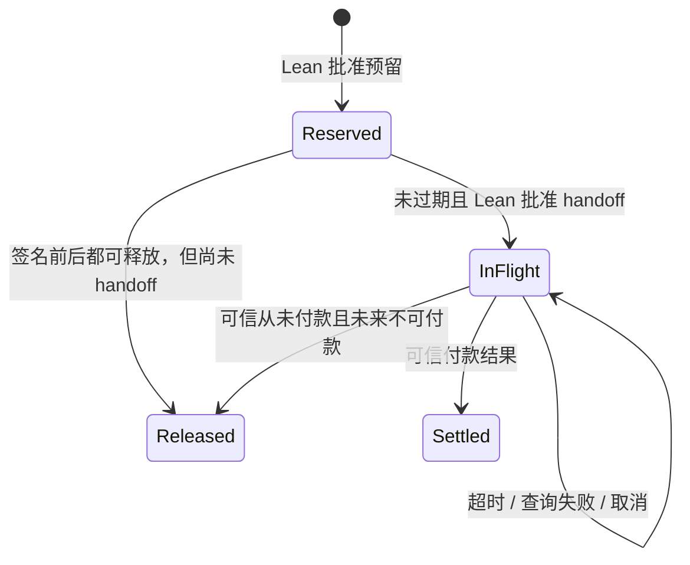

# AgentBudget

多个 Agent 共用任务预算，通过 x402 购买服务。HTTP 超时、迟到签名和重复结果发生时，**Lean 决策核心仍管理每一笔额度**。这是独立的本地实验，没有真实资金、链 RPC 或 A2A 兼容性声明。

```text
确定性 Agent A / B → Lean JSON 行进程 → 允许后签名 / 交出授权
                                           ↓
                                 x402 SDK → 本地收费 HTTP 服务
                                           ↓
                                 模拟结算与查询 → Lean → 事件日志
```

## 运行

需要 Node ≥22、npm、elan，以及 `lean-toolchain` 锁定的 Lean 4.34.0。已在 macOS arm64、Node 25.8.1 上验证。

```bash
npm ci
npm run build
npm test

# 预算充足，两位 Agent 都完成购买
npm run demo -- --config examples/normal.json --scenario normal

# A 超时占用额度，B 被拒绝，A 的最终结果迟到
npm run demo -- --config examples/demo.json --scenario timeout

# 每个演示阶段按回车继续
npm run demo -- --config examples/demo.json --scenario timeout --step

# 使用演示末尾输出的实际日志路径
npm run replay -- artifacts/实际文件名.jsonl
```

日志默认使用唯一文件名；`--log 文件名` 可指定新文件，不覆盖或追加到已有会话。监听地址仅为 `127.0.0.1`，端口自动分配。某些沙箱需要允许本地监听才能运行测试；Lean 构建和证明本身不需要网络依赖。

| 场景 | 配置建议 | 观察点 |
|---|---|---|
| `normal` | `examples/normal.json` | 两笔付款及服务结果 |
| `timeout` | `examples/demo.json` | 超时及查询失败不释放 InFlight |
| `cancel` | `examples/demo.json` | 禁止新预留，仍确认 A 的迟到付款 |
| `late-signature` | 任一示例 | 签名等待期间释放，签完仍拒绝交出授权 |
| `unpaid` | `examples/demo.json` | 模拟器永久禁用授权后才安全回收，B 可购买 |
| `retry` | `examples/demo.json` | 使用相同 nonce 与签名重试，只结算一次 |
| `service-failure` | `examples/normal.json` | 服务 500 与付款成功分别记录 |

需要超时的场景要求 `paymentResultDelayMs > requestTimeoutMs`。暂停观察会让服务后台继续执行；预算仍须收到可信结果才改变。

## 参数

所有必要参数通过 JSON 配置提供；不指定配置或漏字段会明确报错。示例数值仅用于演示。可复制并修改任一示例，无须改代码。

| 字段 | 含义 |
|---|---|
| `total` | 任务总预算，USDC 十进制字符串 |
| `agents.A` / `agents.B` | 各 Agent 请求金额，十进制字符串 |
| `quotes.A` / `quotes.B` | 服务独立报价，须与本次请求金额一致 |
| `reservationTtlMs` | Reserved 的授权交出期限，毫秒 |
| `signingDelayMs` | 本地模拟签名耗时，毫秒 |
| `requestTimeoutMs` | 付款 HTTP 请求超时，毫秒 |
| `paymentResultDelayMs` | 模拟器收到付款后到最终结果的延迟，毫秒 |
| `authorizationValiditySeconds` | SDK 生成授权的有效窗口，秒，至少 10 |

首版只接受 **Base Sepolia / USDC**：`eip155:84532`，资产 `0x036cbd53842c5426634e7929541ec2318f3dcf7e`，6 位小数。此标识用于真实 SDK 消息及签名域，**并未连接测试网**。金额转换只使用字符串和 BigInt，Lean 内使用 Nat；拒绝负数、指数、JSON 数字、超精度和超 uint256 输入。购买金额须大于零，总预算可为零。时间参数是非负安全整数。

控制台每次事件显示总预算、可用、预留、在途、已花费（均为最小单位）；拒绝显示原因。完整 JSONL 保存核心输入、输出、SDK 验证、模拟结算与服务结果。`service.result` 表示服务端已生成结果，不表示超时客户端一定收到了响应。

## 核心与证明

| 文件 | 职责 |
|---|---|
| [AgentBudget/Core.lean](AgentBudget/Core.lean) | 状态、不可变绑定、事件、预算决策、预算守恒 |
| [AgentBudget/Proofs.lean](AgentBudget/Proofs.lean) | 任意事件序列下终态不变、释放后不可在途、账本更新幂等 |
| [Main.lean](Main.lean) | 长驻 JSON 行协议、输入检查、状态序列化 |
| [adapter/x402.ts](adapter/x402.ts) | 官方 SDK、临时签名账户、本地服务与模拟结果证据 |
| [adapter/core.ts](adapter/core.ts) | 唯一 Lean 子进程、FIFO 请求、观察日志 |
| [tests](tests) | 直接调用同一可执行核心的验收与 HTTP 集成测试 |
| [docs/engineering-notes.md](docs/engineering-notes.md) | 来源、版本、阶段学习与未验证问题 |

金额全部由条目状态汇总，避免同时维护易漂移的余额计数器：

```text
可用 = 总预算 − (Reserved + InFlight + Settled)
Released 不占用额度
```

`step` 是唯一提交入口：先生成候选迁移，再在 Lean 内检查总占用与总预算保持一致，超额则拒绝并保留原状态。`Main.lean` 和演示调用的正是被证明的 `step`，不存在另一份 TypeScript 预算实现。

证明不依赖示例数字或有限组测试数据：

- `run_valid` / `initial_budget_conserved`：任意初始预算、任意事件列表下，总占用不超额且五项守恒。
- `ledger_final_idempotent`：确认付款、释放和最终未付款的账本转换重复执行不再改变账本。
- `run_terminal`：对完整管理者的任意后续事件序列，已完成条目的绑定、额度、期限与状态不变。
- `released_never_inFlight` / `released_no_handoff`：已释放条目始终 Released，不能再获准交出授权。

```bash
lake build
lake env lean Audit.lean
```

无 `sorry` 或自定义公理；`Audit.lean` 显示证明使用的 Lean 标准逻辑公理（如 `propext`、`Quot.sound`），用于检查没有 `sorryAx`。这不是签名、SDK、HTTP 或编译器的端到端证明。

## 付款生命周期



SDK 在签名回调之前生成 EIP-3009 nonce。回调将 nonce 作为付款/预留标识，并绑定 Agent、金额、网络、资产、收款方及完整 EIP-712 摘要，先请求 Lean 预留，再进行签名。签完须由 Lean 先转为 InFlight，随后才注册到模拟器并发送付款头。HTTP 重试复用同一授权，不创建第二笔付款。相同标识内容冲突直接拒绝，不截断金额。

取消只阻止新预留；已有 Reserved 的 handoff 仍受原期限控制，已有 InFlight 继续追踪。预留期限在 handoff 时检查；没有会自动回收 InFlight 的后台计时器。签名迟到导致期限已过时，拒绝 handoff 并释放尚未交出的预留。

## 真实与模拟边界

| 部分 | 实现 |
|---|---|
| 报价 | 真实 `ExactEvmScheme.parsePrice` / `enhancePaymentRequirements`，使用整数资产报价 |
| 客户端 | 真实 `x402Client.createPaymentPayload`、EIP-3009 scheme、viem ECDSA 签名 |
| HTTP | 真实本地 402/重试请求，官方 PAYMENT-REQUIRED / SIGNATURE / RESPONSE 编解码 |
| 本地验证 | 真实 facilitator `ExactEvmScheme.verify`、真实 EOA 签名校验；`getCode` 和转账预执行结果为模拟 |
| 结算 | AgentBudget 内存账本；**没有调用 SDK settle，也没有交易广播**；交易标识明确以 `sim:` 开头 |
| 最终查询与禁用 | 自定义封闭模拟器能力，不宣称是通用 x402 查询/撤销 API |
| A2A | 仅核实已发布规范；内部 taskId 不等于真实 A2A Task |

锁定 `@x402/core` / `@x402/evm` **2.28.0**，viem **2.57.7**；检查日期 **2026-10-16**。`package-lock.json` 锁定完整依赖。安装后无需外部凭证。每个 Agent 使用临时随机账户；脚本行为确定，nonce、账户和时间戳按运行生成。

## 验证与限制

`npm test` 编译 Lean、审计证明依赖、检查 TypeScript，再运行 14 项测试，覆盖全部最低验收条件，以及查询失败、安全非付款回收、HTTP 500、重试、并发申请串行化、250 个混合事件和日志重放。正常与超时演示已实际运行。具体观察见 [验收记录](docs/verification.md)。

证明假设：单一管理者串行转换，所有授权都遵循管理者，适配层结果证据真实。JSON 行接口是可信内部接口，`unpaidFinal` 的证据字符串不是密码学证明，普通 Agent 不应拥有直接提交结果事件的权限。未来钱包必须使签名/广播权限无法绕过管理者。

只支持内存状态；JSONL 用于观察和确定性重放，不是持久化恢复协议。进程崩溃后不能重建并继续发送旧授权。链上时间、重组、RPC 一致性、最终确认条件、持久化 outbox 和恢复流程均未实现。授权过期不证明过去未付款。模拟禁用的结论仅适用于本进程控制的账本。

未发现同级 VDSI 项目，本次没有修改其他项目。可复用研究方向是有限资源预留、权限绑定、不确定执行占用与可信结果驱动回收；不将 x402 SDK 引入未来的 VDSI 核心。

## 合作者入口

1. **A2A 薄适配**：按已发布 1.0.0 规范关联真实 Task 和预算，演示 CancelTask 后付款继续确认；先用契约测试澄清重试及阻塞行为。
2. **测试网 facilitator**：替换模拟账本，明确 nonce、交易 hash、链上时间、确认数与查询一致性，设计可信最终未付款证据。
3. **钱包适配**：将本地签名替换为隔离的钱包权限，保留 Lean 批准先于交出授权的顺序。
4. **故障与证明扩展**：进程崩溃、广播响应丢失、RPC 分歧、重组、恢复设计及模型与适配器的进一步精化证明。
